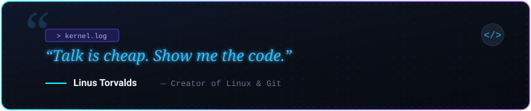

<!-- ===================================================================== -->
<!--                         CTHANHDEV GITHUB PROFILE                      -->
<!-- ===================================================================== -->

<!-- 1. TOP HEADER BANNER -->

  

<!-- 2. GREETINGS & HEADLINE -->
<h1 align="center">
  
</h1>

  <b>Xin chào 🙏 I'm Phi Cong Thanh (cthanhdev)</b> 
  <i>Crafting robust backend services, scalable architectures &amp; modern digital experiences.</i>

  
  
  

---

<!-- 3. ABOUT ME (TWO-COLUMN LAYOUT WITH ROXY SVG) -->
<h2 id="-about-me">💫 About Me</h2>

  

<table border="0" width="100%">
  <tr>
    <td width="62%" valign="top">
      <ul>
        <li>👨‍💻 <b>Backend &amp; Data Engineer</b> with a foundation in <b>Java</b> and enterprise application development.</li>
        <li>⚙️ <b>Building robust backends</b> with <b>Java</b>, <b>Spring Boot</b>, <b>RESTful APIs</b>, and <b>Microservices</b> architecture.</li>
        <li>🐘 <b>Data-driven mindset</b>: strong in <b>SQL</b>, <b>PostgreSQL</b>, schema design, query optimization, and data modeling.</li>
        <li>🔄 <b>Designing data pipelines</b> (<b>ETL/ELT</b>, batch processing) and automation workflows with <b>Python</b>.</li>
        <li>🌊 <b>Expanding into the data ecosystem</b>: Apache Airflow, Kafka, Spark, and data warehousing concepts.</li>
        <li>🐳 <b>Embracing DevOps</b> with <b>Docker</b>, containerization, and <b>GitHub Actions</b> CI/CD.</li>
        <li>🎓 <b>Continuous learner</b>: clean architecture, design patterns, system scalability, and reliable data infrastructure.</li>
        <li>⚡ <b>Always open to discussions</b>, collaboration, and learning with passion &amp; dedication.</li>
        <li>🌟 <i>Big fan of anime aesthetics &amp; pixel art magic (Roxy Migurdia vibes)!</i></li>
      </ul>
       
      <h4>⚡ Follow Me on:</h4>
      

        
        
        
        
      

    </td>
    <td width="38%" align="center" valign="middle">
      
    </td>
  </tr>
</table>

---

<!-- 4. LANGUAGES & TOOLS -->
<h2 id="-languages--tools-i-have-placed-my-hands-on" align="center">🧰 Languages &amp; Tools I Have Placed My Hands On</h2>

  

---

<!-- 5. GITHUB STATS -->
<h2 id="-github-stats" align="center">📊 GitHub Stats</h2>

  
  &nbsp;
  

  

---

<!-- 6. TECH STACK BADGES -->
<h2 align="center">💻 Tech Stack</h2>

  <!-- Core Backend -->
  
  
  
  
   
  <!-- Databases -->
  
  
  
   
  <!-- DevOps & Tools -->
  
  
  
  
  
   
  <!-- IDEs & Build -->
  
  
  

---

<!-- 7. DEV QUOTE -->
<h2 align="center">💬 Words of Wisdom</h2>

  

---

<!-- 8. FOOTER SKYLINE BANNER -->

  

